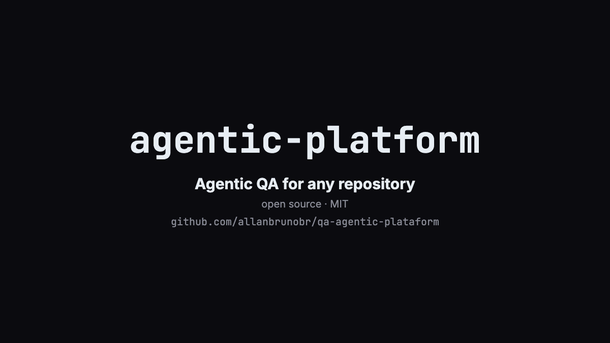
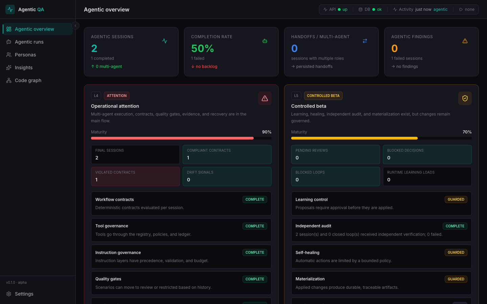
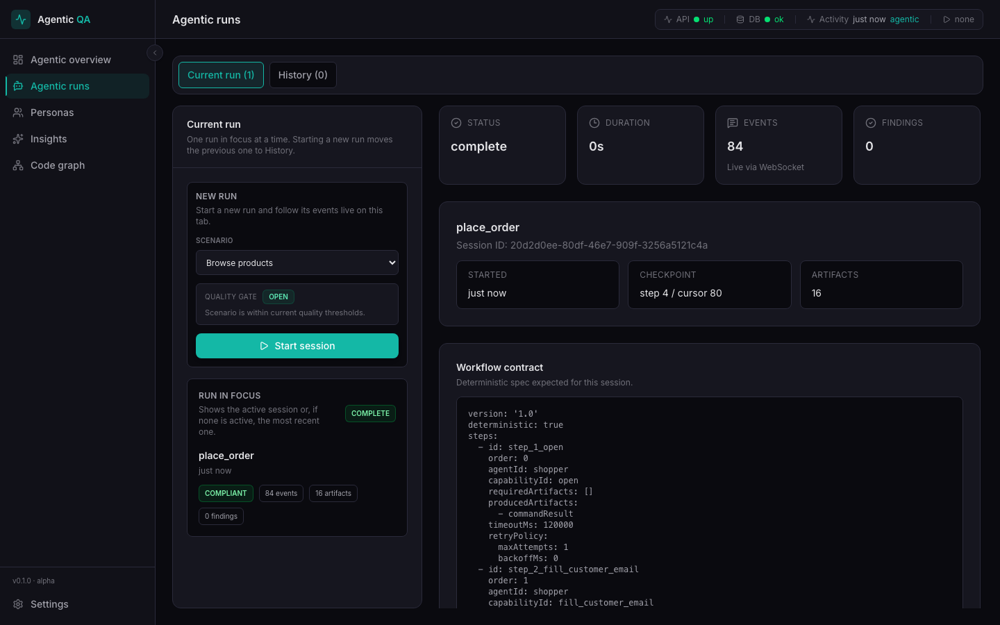

# Agentic Platform

[](https://github.com/allanbrunobr/qa-agentic-platform/actions/workflows/ci.yml)
[](LICENSE)


Agentic QA for any repository, without touching its code.

`agentic-platform` installs a self-contained `.agentic-qa/` runtime inside a target repository. The runtime reads the repository, infers roles, routes, and scenarios, and runs multi-agent QA flows (Playwright in a real browser for frontends). Each run is checked against deterministic workflow contracts and quality gates.



> **Status: alpha.** The runnable path is strongest for web frontends. Backend API, CLI, library, and unknown repositories get draft adapters and deterministic smoke runs, not product validation. See [Scope and limitations](#scope-and-limitations).

## Contents

- [How it works](#how-it-works)
- [Design highlights](#design-highlights)
- [Requirements](#requirements)
- [Quick start](#quick-start)
- [Configuration](#configuration)
- [Platform dashboard (optional)](#platform-dashboard-optional)
- [Development and verification](#development-and-verification)
- [Scope and limitations](#scope-and-limitations)
- [Repository layout](#repository-layout)
- [Documentation](#documentation)
- [License](#license)

## How it works

```text
 agentic-platform (this repo)                 target repository
 ────────────────────────────                 ───────────────────────────────
 install-local  <repo>  ───────────────────▶  <repo>/.agentic-qa/
                                              ├─ dashboard (web + API)
 discover-local <repo>  ───────────────────▶  ├─ adapter/   roles, routes, personas,
                                              │             scenarios, workflow contracts
                                              └─ scripts/start-local-dashboard.generated.sh
                                                            │
                                                            ▼
                                          multi-agent runs ──▶ the running app
                                          (Playwright)         (PLAYWRIGHT_BASE_URL)
```

1. **Install.** `install-local` copies the runtime template (`templates/persona-qa-dashboard`) into `<repo>/.agentic-qa/`. It also writes a launcher, `.env.example`, and, when a provider key resolves, `.env.local`.
2. **Discover.** `discover-local` identifies the repository type (frontend, backend API, CLI, library, monorepo, unknown). It finds surfaces, roles, routes, and scenarios, and writes the results to `.agentic-qa/adapter/` as reviewable generated files.
3. **Run.** The launcher starts a local dashboard and API on isolated ports. From the dashboard you start runs. Agents drive the application at `PLAYWRIGHT_BASE_URL`. Each run records events, artifacts, findings, and a contract verdict.

The host application code is never modified. Everything lives in `.agentic-qa/`, which you can delete at any time.



## Design highlights

Some engineering decisions that shape the project:

- **Verdicts come from contracts, not from the model.** Each scenario has a deterministic workflow contract (YAML) with the expected steps, order, capabilities, and artifacts. After a run, the observed run is compared with the contract ("spec vs actual"), and the verdict is `contract_compliant`, `contract_drift`, or `contract_violated`. The agent cannot declare its own success.
- **Fail closed.** An early version reported a pass when a generic step could not find its control. Now a missing or disabled control fails the step, and the final assertion needs visible success feedback. `npm run test:e2e` guards this in CI: it runs the storefront example, then removes the app's success message and expects `contract_violated`.
- **Reproducible without a model.** A deterministic runtime drives the same Playwright flows without an API key. CI and the demo use it, so results do not depend on model output.
- **Non-invasive by construction.** Everything is written to `<repo>/.agentic-qa/`. The runtime binds to localhost, keeps keys in a git-ignored `.env.local` with `0600` permissions, and uses a shim over Node's built-in `node:sqlite`, so there are no native builds in the target repository.
- **Discovery from code, reviewed by people.** A TypeScript AST scan builds a code graph (routes, forms, buttons, endpoints, HTTP calls). Personas, capabilities, and scenarios are derived from that graph. They are written as generated files, and scenarios stay drafts until a person reviews them.
- **Governed autonomy.** Tool calls go through a registry with risk policies and a ledger. The self-improvement loops (L4/L5) only propose changes: new scenarios, prompt overlays, and healing actions need approval and are logged. See [docs/architecture.md](docs/architecture.md).

## Requirements

| Requirement | Notes |
| --- | --- |
| Node.js **22.13+** | Uses the built-in `node:sqlite`. Check with `node -v`. |
| npm | Comes with Node. |
| macOS or Linux | The generated launcher is a Bash script. On Windows, use WSL. |
| Chromium for Playwright | On the first launch, the launcher downloads Chromium if it is not already available. |
| Anthropic or OpenAI API key | Needed only for model-backed frontend runs. Not needed for deterministic runs (see below). |

## Quick start

This walkthrough uses the bundled example app in [`examples/storefront`](examples/storefront). To use your own project, replace the path with the absolute path of your repository.

**1. Clone and install**

```bash
git clone https://github.com/allanbrunobr/qa-agentic-platform.git
cd qa-agentic-platform
npm install
```

**2. Install `.agentic-qa` into the target and run discovery**

```bash
TARGET="$PWD/examples/storefront"

npm run install-local -- "$TARGET"
npm run discover-local -- "$TARGET"
```

Discovery writes generated files such as `adapter/scenarios/scenarios.generated.json` and `adapter/workflow-contracts/*.generated.yaml` to `$TARGET/.agentic-qa/`. For the example app, it finds two scenarios: `browse_products` and `place_order`.

**3. Start the application under test**

The example app is a single static page. Any static server works:

```bash
cd "$TARGET" && python3 -m http.server 8080 --bind 127.0.0.1
```

For your own project, start it the way you usually do (`npm run dev`, etc.) and note its URL.

**4. Start the generated dashboard** (in a second terminal)

```bash
cd "$TARGET/.agentic-qa"
PLAYWRIGHT_BASE_URL=http://127.0.0.1:8080 \
  ./scripts/start-local-dashboard.generated.sh --api-port 3208 --web-port 5184
```

On the first start, the launcher installs the workspace dependencies and the Playwright Chromium browser. This can take a few minutes. When `starting web on 5184` appears, open <http://localhost:5184>.

**5. Start a run**

Open **Agentic runs**, select a scenario, and click **Start session**. The page then shows live events, artifacts, the workflow contract, and the final verdict.



### Without an API key

If no provider key is configured, model-backed runs are rejected with this message: `The configured anthropic provider is not ready… ANTHROPIC_API_KEY is missing.` To run the scenarios with deterministic tools (no LLM calls), start the dashboard with `AGENTIC_QA_FORCE_DETERMINISTIC_RUNTIME=1`:

```bash
AGENTIC_QA_FORCE_DETERMINISTIC_RUNTIME=1 PLAYWRIGHT_BASE_URL=http://127.0.0.1:8080 \
  ./scripts/start-local-dashboard.generated.sh --api-port 3208 --web-port 5184
```

### Removing it

```bash
rm -rf "$TARGET/.agentic-qa"
```

## Configuration

Copy `.env.example` to `.env.local` at the root of this repository. Then fill in **one** provider key. `.env.local` is ignored by git.

```bash
cp .env.example .env.local
```

The installer looks for the Anthropic key in these sources, in order. It uses the first match:

1. `ANTHROPIC_API_KEY_OVERRIDE`
2. `agentic-platform/.env.local`
3. `ANTHROPIC_API_KEY`
4. `ANTHROPIC_API`
5. the target's `.agentic-qa/.env.local`

The installer looks for the OpenAI key in these sources, in order: `agentic-platform/.env.local`, `OPENAI_API_KEY`, the target's `.agentic-qa/.env.local`. In the generated dashboard, **Settings** selects the provider for the next run.

Runtime variables, read by the generated runtime:

| Variable | Used for |
| --- | --- |
| `PLAYWRIGHT_BASE_URL` | Base URL of the frontend under test. |
| `HEADLESS` | Set `false` to show the browser during runs. |
| `AGENTIC_QA_FORCE_DETERMINISTIC_RUNTIME` | Set `1` to run with deterministic tools and no model calls. |
| `GENERIC_API_BASE_URL` / `TARGET_API_BASE_URL` / `API_BASE_URL` | Real HTTP probes for backend API repositories. |
| `GENERIC_CLI_COMMAND` / `TARGET_CLI_COMMAND` | CLI to probe when the `bin` entry in `package.json` is not sufficient. |
| `AGENTIC_QA_TEMPLATE_ROOT` | Installer only. Absolute path to an alternative runtime template. |

If the adapter cannot infer application credentials (login users, seed data) from the repository, supply them yourself.

## Platform dashboard (optional)

This repository also includes a control-plane UI. Use it to review discovery and bootstrap output, promote adapters (`generated → reviewed → certified`), and start executions:

```bash
npm run dev:api   # http://localhost:3101
npm run dev:web   # http://localhost:4177
```

## Development and verification

The runtime template has its own lockfile. Install it once, next to the root dependencies:

```bash
npm install
npm run setup:runtime   # npm ci in templates/persona-qa-dashboard
```

| Command | What it checks | Time |
| --- | --- | --- |
| `npm run typecheck` | TypeScript for the platform packages, the runtime API, and the runtime web app | ~1 min |
| `npm test` | Unit and discovery verifiers, runtime API Vitest suite and route tests, runtime web Vitest suite | ~2 min |
| `npm run test:e2e` | The quick start end to end: install and discover on a temp copy of `examples/storefront`, start the launcher, run `place_order` in real Chromium (expects `contract_compliant`), then break the app and expect `contract_violated` | ~3 min (first run longer) |
| `npm run verify:release` | Release gate (below) | ~5 min |

CI ([`.github/workflows/ci.yml`](.github/workflows/ci.yml)) runs all four on every push and pull request, plus a secret scan.

Run the release gate before you merge changes to the installer, template, runtime, or dashboard:

```bash
npm run verify:release
```

The gate runs these checks:

- syntax checks for every verifier
- domain discovery contracts and static frontend scanner checks
- domain fixture matrix and domain specialist service checks
- install, discovery, and deterministic runtime smokes against generated frontend, backend API, CLI, library, and unknown repository fixtures
- the runtime API route tests and full Vitest suite, the web Vitest suite, and the web production build

The gate does not need an API key or network access to an application. If local ports are busy, override `API_PORT`, `WEB_PORT`, or `RELEASE_PORT_SEED`.

A passing run ends with:

```text
[verify-release] PASS release verification
```

Other verifiers are available as `npm run verify:<name>`. See the `scripts` section of `package.json` and [docs/testing.md](docs/testing.md).

## Scope and limitations

- **Frontends:** full path. Discovery maps routes, inputs, and buttons, and orders steps as open → fill → act → assert. Runs drive a real browser through Playwright. Generic capabilities fail closed: a step fails if its control is missing or disabled, and the final assertion passes only when visible success feedback appears (for example "submitted" or "saved"). For anything more specific, map selectors and assertions for that repository.
- **Backend API, CLI, library, monorepo, unknown:** discovery classifies the repository and generates draft personas, scenarios, and capability stubs. Runs are deterministic smoke and inspection runs. They make missing mappings visible, but they **do not validate business behavior**. Business validation needs runtime URLs or commands, auth, seed data, and assertions mapped for that repository.
- **Generated scenarios are review-gated.** They stay drafts until a person maps them.
- **L5 loops are controlled.** The loops cover coverage gaps, scenario drafts, profile tuning, learning proposals, and self-healing. Their changes are recommendations or drafts, and self-healing is bounded and logged.

## Repository layout

| Path | Contents |
| --- | --- |
| `packages/dashboard-api/` | CLI (`install-local`, `discover-local`, …), discovery, package generation, platform API |
| `packages/dashboard-web/` | Platform control-plane UI |
| `packages/core/` | Shared runtime pieces |
| `packages/host-sdk/` | Host adapter contracts |
| `templates/persona-qa-dashboard/` | Runtime template copied into `<repo>/.agentic-qa/` |
| `adapters/` | Reference adapters: `template` (starting point for a host) and `reference-store` (fictitious order-fulfilment host used by the built-in reference scenarios) |
| `examples/storefront/` | Minimal app for the quick start |
| `scripts/` | Verifiers used by `verify:*` and the release gate |
| `docs/` | Architecture, generated files, testing, and decision records |
| `.github/workflows/` | CI |

## Documentation

- [Architecture](docs/architecture.md): components, data flow, maturity levels L1–L5, security boundaries
- [Generated files](docs/generated-files.md): what `install-local` and `discover-local` write, and what to review
- [Testing](docs/testing.md): test layers and how to run each one
- [Decision records](docs/decisions/): why the runtime is host-local, why runs are checked against deterministic contracts, why generic capabilities fail closed, how repository content is treated as untrusted
- [Contributor and agent guidelines](AGENTIC.md)
- [Changelog](CHANGELOG.md)

## License

[MIT](LICENSE) © 2026 Allan Bruno
